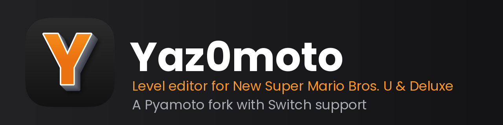

## Overview
Yaz0moto is a level editor for **New Super Mario Bros. U** (Wii U) and **New Super Mario Bros. U Deluxe** (Switch), with full tileset editing for both games.

It is a fork of [Pyamoto](https://github.com/Zenith-Team/Pyamoto) by Zenith Team, which is itself a fork of [Miyamoto!](https://github.com/aboood40091/Miyamoto). Yaz0moto adds Deluxe support, using code from Miyamoto! DX. It is maintained by [Steammaker212](https://github.com/Steammaker212). See [CREDITS.md](./CREDITS.md) for everyone whose work this builds on.

## Installation
Download the latest build for your system from the [releases page](https://github.com/Steammaker212/Yaz0moto/releases/latest):

| System | File |
|---|---|
| Windows (x64) | `Yaz0moto-v<version>-Windows-x64.zip` - unzip and run `Yaz0moto.exe` |
| macOS (universal) | `Yaz0moto-v<version>-macOS-universal.zip` - unzip and open `Yaz0moto.app` |
| Linux (x86_64) | `Yaz0moto-v<version>-Linux-x86_64.AppImage` (or the `.zip`) |

The builds are not code-signed, so Windows SmartScreen or macOS Gatekeeper may warn you the first time; on macOS, right-click the app and choose *Open*. Yaz0moto checks this project's releases for updates (see Preferences).

On first launch, the setup wizard helps you download the required data and point the editor at your game files. If you used Pyamoto before, your settings and data are copied across automatically (Pyamoto itself is left untouched).

## Usage
General editing works as in Pyamoto; the [NSMBU wiki](https://zenith.nsmbu.net/wiki/Miyamoto_Level_Editor) has a guide.

### New Super Mario Bros. U Deluxe
Pick *New Super Mario Bros. U Deluxe* in the setup wizard (or **Preferences > Game Setup**) and select the `Course` folder from your dumped game's `romfs`. The `Unit` folder, where Deluxe keeps its tilesets, must sit right next to it. See [Deluxe-Setup.md](./Deluxe-Setup.md) for the full walkthrough.

- Levels are saved as plain little-endian `.sarc` files.
- **Edit Tilesets** opens the exact tileset files the open level uses, and saves them back into `Unit`. *Export Tileset* writes a standalone `.szs`, and *Import Tileset from file* reads one.
- In the zone Background tab, the file name shown is the real Deluxe one (`dv_<name>.Nin_NX_NVN.szs`, in `romfs/Model`), which is where a custom background model goes.
- Opening a level from the other game offers to switch games; switching game in Preferences starts a new level.

You must provide your own legally obtained game files.

## Changelog
Read the [changelog](./CHANGELOG.md) for a full list of changes and additions.

## Contributing
Bug reports and feature requests go in the [Issues tab](https://github.com/Steammaker212/Yaz0moto/issues). Pull requests are welcome; see [Running from Source](#running-from-source) to set up a development environment. Maintainers: see [docs/RELEASING.md](./docs/RELEASING.md). `tests/deluxe_smoke_test.py` and `tests/branding_test.py` are quick checks to run before sending a change.

## Running from Source

**Prerequisites:** [Python 3](https://www.python.org/downloads/) (Windows: check "Add Python to PATH" during install), Git, and a C compiler for the Cython extensions (Windows: Visual Studio Build Tools with the *Desktop development with C++* workload).

```bash
git clone --recurse-submodules https://github.com/Steammaker212/Yaz0moto
cd Yaz0moto
bash setup_venv.sh

# macOS/Linux
.venv/bin/python3 yaz0moto.py

# or on Windows:
.venv\Scripts\python yaz0moto.py
```

Windows users can follow [Deluxe-Setup.md](./Deluxe-Setup.md), which covers building the required extension step by step.

## License
Yaz0moto is free software under the GNU General Public License v3.0, like the projects it is based on. See [license.txt](./license.txt).

### Disclaimer
AI tools are used in the development of this program.
